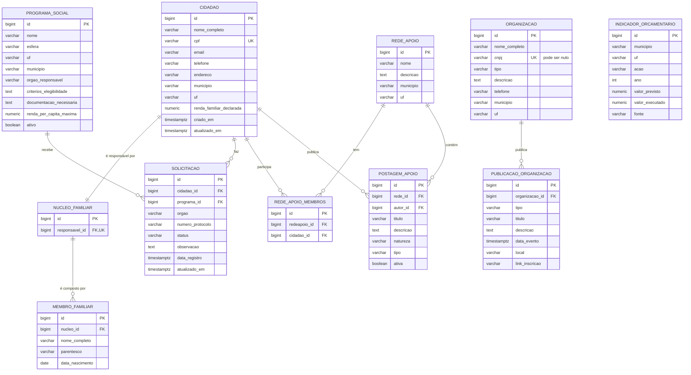

# DER — Diagrama Entidade-Relacionamento

Corresponde ao script `database/schema.sql`.

`INDICADOR_ORCAMENTARIO` não se relaciona com outras tabelas: é dado público ligado ao município (`municipio` + `uf`).
