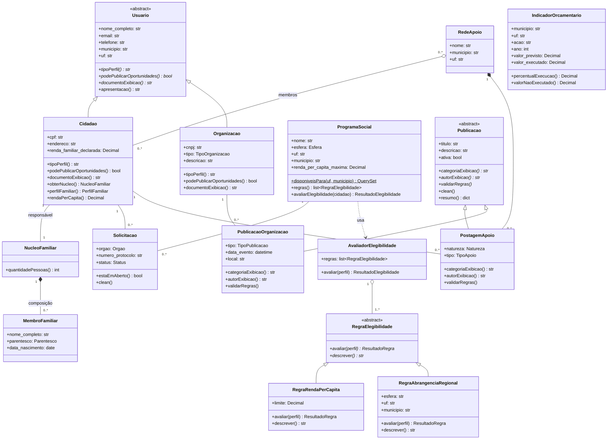

# Diagrama de Classes — ElosPúblicos

Diagrama em Mermaid (o GitHub desenha automaticamente). Corresponde às classes de `src/core/models.py` e `src/core/dominio/elegibilidade.py`.

## Onde estão os pilares de POO

| Pilar | Onde |
|---|---|
| Classe abstrata | `Usuario`, `Publicacao` (models) e `RegraElegibilidade` (domínio): usam `ABCMeta` e `@abstractmethod`, não podem ser instanciadas |
| Herança | `Cidadao` e `Organizacao` ← `Usuario`; `PostagemApoio` e `PublicacaoOrganizacao` ← `Publicacao`; `RegraRendaPerCapita` e `RegraAbrangenciaRegional` ← `RegraElegibilidade`; todas as views herdam das views genéricas do Django |
| Polimorfismo (`@override`) | Métodos sobrescritos com o decorador `@override` (equivalente ao `@Override` do Java). Ex.: o mural chama `resumo()` em postagens e publicações sem saber a classe; o avaliador chama `avaliar()` em cada regra |
| Composição 1:N | `NucleoFamiliar` ◆ `MembroFamiliar` (apagou o núcleo, apagou os membros) e `RedeApoio` ◆ `PostagemApoio` |
| Encapsulamento | Regras de negócio dentro das classes (`clean()`, `validarRegras()`, `estaEmAberto()`), CPF exibido mascarado por `documentoExibicao()` |
